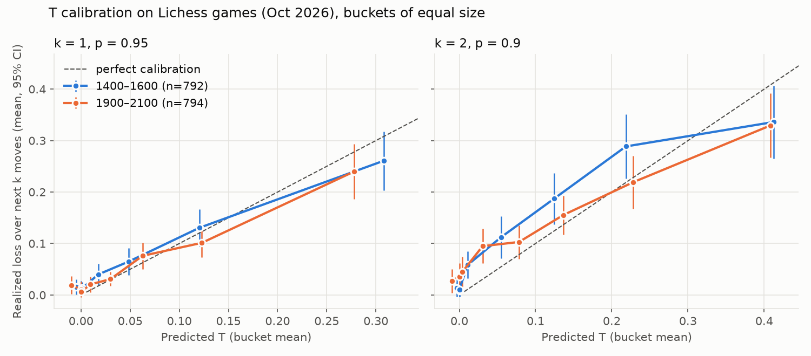
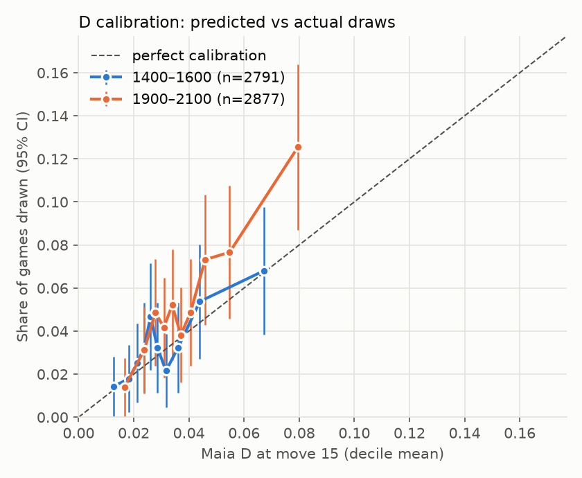

# Phase 2 report: does the metric measure something real?

Nov 12, 2026. Settings unless noted: Stockfish 19 at 50k nodes (cleared hash per search), Maia3-5M with real move history, d = 0.5. Raw results are in `validation/results/`; every number below can be regenerated with the commands at the end.

## Verdict (for Henry to decide)

- **T: yes, it measures something real.** On 1,586 positions from real Lichess games, predicted T rises with the loss players actually suffer over their next moves. The rank correlation is about 0.5 and the calibration line is roughly diagonal in both rating bands (plot below). On identical positions T falls as rating rises.
- **D: calibrated, but weak at move 15.** When Maia says a 5% draw chance, about 5% of games are drawn. But at move 15 nearly every game sits between 1% and 8%, so D only modestly separates drawish games from the rest (AUC 0.61–0.64). It still separates drawn endings from sharp openings cleanly (0.5–0.96 vs 0.02).
- **Two rows of the spec's sanity table are wrong as written, and the tablebase proves it** (details below). Blocked pawns with *active* kings aren't always ~0, and R+B vs R isn't "high for the defender" at a 2-move horizon. T gets these right; the expectations don't hold.

## 1. Sanity positions

> **Update (after Henry's decisions, DECISIONS 2.9 and 2.10):** two spec rows changed. R+B vs R now expects "defender above the attacker, and falling with rating"; blocked pawns now means "neither king can get in", tested on four sealed walls (all T = 0.000). With those, **20 of 24 checks pass at k = 2** (22 of 24 at k = 1). Remaining at k = 2: the Scholar's-mate trap at all three ratings, and 2 of 24 position-sides whose T doesn't fall with rating. The tables below are the original run against the original wording; the current results are in `results/sanity_k2.md`.


20 positions in `validation/positions.yaml`, ratings 1100/1500/1900 (both players), k = 2, p = 0.9. Full table: `results/sanity_k2.md` (k = 1: `results/sanity_k1.md`).

| Check (each rating) | k = 2 | k = 1 |
| --- | --- | --- |
| Rook vs rook: T ≈ 0 for both | **pass** (max 0.005) | pass |
| Blocked pawns: T ≈ 0 for both | **fail**: wall 0.00, but two positions 0.13–0.31 | fail |
| Sharp openings: T medium | **pass** (mean 0.18–0.25) | pass (0.08–0.11) |
| R+B vs R: attacker T ≈ 0 | **pass** (max 0.003) | pass |
| R+B vs R: defender T high | **fail**: mean 0.04–0.10 | fail |
| Trap: victim T > trapper T | **fail** in 1 of 6 traps (Scholar's mate) | **pass**, all 6 |
| Ordering: R+B defender > sharp > R vs R | **fail** (defender too low) | fail |
| D: rook vs rook > sharp opening | **pass** (0.52–0.67 vs 0.02–0.03) | n/a |
| T falls as rating rises | **pass** on average (0.264 → 0.220 → 0.173); 22 of 24 position-sides individually | pass on average |

### Why the failures happened

I checked each one against **exact tablebase values** (Lichess 7-piece tablebase), recomputing T with perfect leaf values instead of Stockfish (`results/tablebase_check.log`):

| Position | Exact T (1100 / 1500 / 1900) | Our T | Conclusion |
| --- | --- | --- | --- |
| blocked_queenside, White | 0.34 / 0.23 / 0.16 | 0.30 / 0.19 / 0.13 | **T is right.** One king move loses the opposition; it's a tricky king-and-pawn ending, not a dead one. I mislabeled it. |
| R+B vs R #1, defender | 0.00 / 0.00 / 0.00 | 0.01–0.03 | **T is right.** Maia puts 0% on the two losing moves. |
| R+B vs R #2, defender to move | 0.16 / 0.12 / 0.06 | 0.15 / 0.12 / 0.06 | **T is right, almost exactly.** |
| R+B vs R #2, attacker to move, defender's T | 0.00 / 0.00 / 0.00 | 0.21 / 0.18 / 0.11 | **T is wrong here.** Stockfish without tablebases misjudges R+B vs R or picks a different best move. Fixable (see proposals). |

- **"Blocked pawns with active kings ≈ 0"** only holds when the kings truly can't get in (the full pawn wall: 0.000). When a king *can* get in, one wrong king move loses, and T rightly says so.
- **"R+B vs R: high for the defender"** doesn't hold at k = 2. Club players don't lose R+B vs R in their next two moves: Maia puts 0–3% on the tablebase-losing moves. They lose it by slow drift over 30+ moves, which a 2-move horizon can't see. This is a limit of T's definition, not a bug.
- **Scholar's mate at k = 2:** Black's 3…Nf6?? is played only 10–12% of the time even at 1100, so the victim's T is low (0.11). The "trapper" scores higher because 3.Qh5 leaves White's own next move delicate. At k = 1 the check passes.

## 2. T on real games

400 Lichess games per band (Oct 2026, rated blitz/rapid/classical, both players in band), one random position per game, T for both players. Realized loss = the player's own loss over their next k moves (Stockfish v\* before minus after each move).



| Band | Setting | Mean T | Mean realized loss | Slope | Rank correlation |
| --- | --- | --- | --- | --- | --- |
| 1400–1600 | k=1, p=0.9 | 0.058 | 0.069 | 0.75 | 0.50 |
| 1400–1600 | **k=2, p=0.9** | 0.102 | 0.127 | 0.80 | 0.56 |
| 1900–2100 | k=1, p=0.9 | 0.059 | 0.063 | 0.81 | 0.49 |
| 1900–2100 | **k=2, p=0.9** | 0.109 | 0.126 | 0.68 | 0.51 |

All six (k, p) settings are in `results/calibration.md`.

- **T is calibrated to within about a third.** It slightly under-predicts on average (0.10–0.11 predicted vs 0.13 realized at k = 2). Positions where T says 0 do lose about 0.01–0.03, and the top bucket (T ≈ 0.4) loses about 0.33.
- **The data can't tell the settings apart.** The 90% bootstrap intervals of relative calibration error overlap almost entirely (k=1 p=0.95: 0.22–0.39; k=2 p=0.9: 0.27–0.40). p barely matters.
- **Mean T is about the same in both bands (0.10 vs 0.11), and so is realized loss (0.127 vs 0.126).** That isn't a contradiction of "T falls with rating": stronger players reach harder positions. On *identical* positions, T falls with rating (section 1).

## 3. D on real games

D at ply 30 (after move 15) for every game reaching it: 2,791 and 2,877 games.



| Band | Draw rate | Brier score: always guess the base rate | Brier: Maia D | Brier: Stockfish's draw % | AUC: Maia D | AUC: Stockfish |
| --- | --- | --- | --- | --- | --- | --- |
| 1400–1600 | 3.4% | 0.0332 | 0.0329 | 0.2608 | 0.61 | 0.55 |
| 1900–2100 | 5.5% | 0.0519 | 0.0516 | 0.3545 | 0.64 | 0.56 |

- Maia's D is **calibrated** (the points sit on the diagonal) and ranks drawn games above decisive ones better than chance (AUC 0.61–0.64).
- It's only a little better than always guessing the draw rate (Brier 0.0329 vs 0.0332), because club games at move 15 are almost never drawish.
- Stockfish's draw probability is **badly wrong for human games** (Brier 0.26–0.35: it averages 30–41% draw where 3–5% happen). That confirms the spec's choice of Maia for D.

## 4. Tuning

| Parameter | Best fit | Recommended | Why |
| --- | --- | --- | --- |
| k | no significant difference | **2** | Same calibration as k = 1, slightly better ranking in the lower band, and it sees two-move combinations (traps, Kasparov's 25.Re7+) that k = 1 misses. |
| p | no significant difference | **0.9** | p = 0.8–0.95 all within noise. 0.9 is the cost middle. |
| ε (stability) | 0.005 (rank corr −0.46) | **0.01** (−0.43) | Within noise of the best. Smaller than 0.01 counts moves Stockfish can't really separate at 50k nodes. |
| δ (trap) | 0.01 (rank corr +0.55) | **0.05** (+0.48) | The fit keeps improving as δ shrinks, because "trap mass" turns into "chance of any inaccuracy". 0.05 keeps it meaning a real error, for a small loss of fit. |

**Approved by Henry (2026-11-12): k = 2, p = 0.9, ε = 0.01, δ = 0.05.** These are now the CLI defaults (DECISIONS 2.7).

## 5. Proposals (need your decision)

1. **Accept T as meaningful and go to Phase 3.** My recommendation.
2. **Change the spec's Purpose table:** "blocked pawns, kings can't get in" instead of "active kings", and drop "R+B vs R high for the defender", or mark it as beyond a 2-move horizon.
3. **Done (DECISIONS 2.11): Syzygy tablebases are used when present.** Originally proposed: **give Stockfish Syzygy tablebases** (5-piece set ≈ 1 GB; Stockfish's `SyzygyPath` option). That fixes the one case where T was wrong (R+B vs R #2 with the attacker to move) and makes every ≤ 5-piece endgame exact.
4. **D: keep it, but label it honestly** as "chance this game ends drawn", not "how sharp". The IDEAS.md note about a relative D still stands.

## Limits of this validation

- One month of online blitz/rapid (no classical-only sample), and 400 positions per band for T.
- Realized loss is measured with the same Stockfish settings as T. Shared engine error can't be fully separated, though the tablebase checks show it's small except where noted.
- T assumes a perfect opponent, while the realized games had human opponents. Realized loss counts only the player's own moves, which keeps the comparison fair.

## Reproduce

```bash
spikes/.venv/Scripts/python tools/fetch_lichess_sample.py --month 2026-10 --per-band 3000
```

```bash
target/release/validate sanity --positions validation/positions.yaml --out validation/results/sanity.json
```

```bash
target/release/validate draws --games validation/data/band_1400_1600.pgn --out validation/results/d_1400_1600.jsonl
```

```bash
target/release/validate sample --games validation/data/band_1400_1600.pgn --limit 400 --out validation/results/t_1400_1600.jsonl
```

```bash
spikes/.venv/Scripts/python validation/sanity_checks.py --k 2
```

```bash
spikes/.venv/Scripts/python validation/calibrate.py
```

(Repeat the `draws` and `sample` lines for `band_1900_2100`.)
